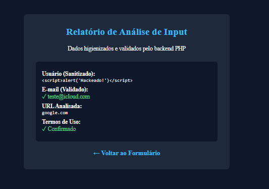

[ 🇺🇸 English ](README.md) | [ 🇪🇸 Español ](README.es.md) | [ 🇧🇷 Português ](README.pt.md)

---

#  Secure Input Validation & Sanitization Engine (PHP/HTML5)

A lightweight web application built with PHP and HTML5 designed to demonstrate input sanitization and defense mechanisms against Cross-Site Scripting (XSS) and parameter manipulation attacks.
##  Purpose & Scope
This project serves as a practical implementation of secure input processing in web environments. It simulates a threat analysis form where user inputs are strictly sanitized and validated on the server side before rendering or processing.

##  Security Features Implemented
**XSS Mitigation:** Utilization of `htmlspecialchars()` with `ENT_QUOTES` and `UTF-8` encoding to prevent Reflected and Stored Cross-Site Scripting.
**Email Validation:** Native PHP filtering via `filter_var(..., FILTER_VALIDATE_EMAIL)` to enforce RFC compliance.
**HTTP Method Enforcement:** Enforces `POST` request method for data transmission, preventing sensitive data exposure via URL/GET query strings or HTTP access logs.
**Strict State Checking:** Server-side verification for terms acceptance using strict comparison operators (`===`).

##  Proof of Concept (XSS Defense Test)
When submitting an XSS payload in the username field:
html

Result: The backend neutralizes the executable script and safely renders the plain text string as &lt;script&gt;alert('XSS')&lt;/script&gt;. No client-side JavaScript execution occurs.

##  How to Run

1. Clone this repository into your local web server environment (e.g., XAMPP htdocs or LAMP /var/www/html/).
2. Start the Apache service.
3.Access http://localhost/01-input-validation-security/Projeto1.php in your browser.

Developed as part of the Cybersecurity Portfolio for international software & threat analysis roles.
